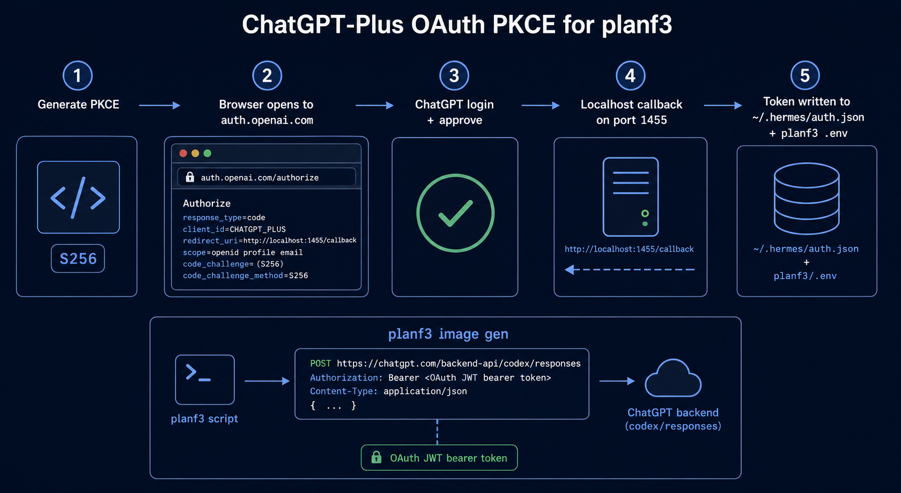

# planf3 + ChatGPT-Plus OAuth PKCE

A drop-in ChatGPT-Plus OAuth PKCE login flow that turns a `chatgpt.com` browser login into a refreshable Bearer token, plus planf3 image-gen scripts rewired to use that token against the Codex Responses API. No `sk-...` API key required — your ChatGPT-Plus subscription powers the image work.



## What's in this repo

| Path | What it does |
| --- | --- |
| `hermes_oauth_openai_codex/` | Standalone, stdlib-only Python package. Runs the PKCE flow, exchanges the code for OAuth tokens, writes them to `~/.hermes/auth.json` in Hermes's credential-pool shape, and pushes the derived Bearer key into the planf3 `.env`. Mirrors Hermes's existing Anthropic-PKCE pattern (`agent/anthropic_adapter.py`); swaps in `auth.openai.com` endpoints and the documented Codex PKCE flow. |
| `planf3-image-scripts/` | Modified versions of planf3's `generate_gpt_image.py` and `edit_gpt_image.py`. They hit `https://chatgpt.com/backend-api/codex/responses` with the OAuth Bearer token (instead of `api.openai.com/v1/images/generations`) and stream the SSE response to extract the rendered PNG. Shared helpers live in `_codex_common.py`, including a JWT-expiry-aware auto-refresh that calls the OAuth module's `refresh` subcommand when the token is within 48 hours of expiry. |

## Why this exists

Planf3's image-gen scripts (`generate_gpt_image.py`, `edit_gpt_image.py`) call `api.openai.com/v1/images/generations`, which requires a paid OpenAI API key (`sk-...`). ChatGPT-Plus subscribers get a different token — an OAuth Bearer issued by `auth.openai.com` — that does *not* work against `api.openai.com/v1/...`. To unlock image generation with a ChatGPT-Plus subscription, the request has to go through ChatGPT's Codex Responses API at `chatgpt.com/backend-api/codex/responses`, which is what the ChatGPT-Plus OAuth token actually grants access to.

This repo provides both halves of that bridge: the login that issues the token, and the scripts that know how to spend it.

## Install

```bash
# 1. Clone
git clone https://github.com/<you>/planf3-chatgpt-pkce.git
cd planf3-chatgpt-pkce

# 2. Install the OAuth module
pip install --user ./hermes_oauth_openai_codex

# 3. Drop the image scripts into your planf3 install (or use them in-place)
cp planf3-image-scripts/*.py ~/.claude/skills/planf3/scripts/
```

`pip install --user` puts the `hermes-oauth-codex` shim at `~/.local/bin/` (POSIX) or `%APPDATA%\Python\Python3xx\Scripts\` (Windows). If that directory isn't on `PATH`, fall back to `python -m hermes_oauth_openai_codex ...`.

## First-time login

```bash
hermes-oauth-codex login
```

This opens your default browser to `https://auth.openai.com/oauth/authorize?code_challenge=...&code_challenge_method=S256&...`, waits for the redirect to `http://localhost:1455/auth/callback`, exchanges the code for tokens, and writes:

- `~/.hermes/auth.json` — credential-pool entry under provider `openai-codex-pkce` (coexists with Hermes's existing `openai-codex` device-code provider; the existing entries are preserved)
- `~/.hermes/.openai_codex_oauth.json` — raw OAuth token cache (camelCase, mirrors Hermes's `.anthropic_oauth.json`)
- `~/.claude/skills/planf3/.env` — `OPENAI_API_KEY=<OAuth bearer JWT>`

If port `1455` is busy, the module falls back to `1457` automatically. If the browser fails to open, the authorize URL is printed to stdout so you can paste it manually. The whole flow completes in under a minute.

## Use planf3's image scripts

After login, planf3 image generation works end-to-end against your ChatGPT-Plus subscription:

```bash
# From the planf3 skill directory (so the .env is picked up)
cd ~/.claude/skills/planf3
python scripts/generate_gpt_image.py "A sunset over mountains" sunset.png --size 1024x1024 --quality medium

# Edits / compositions
python scripts/edit_gpt_image.py "Add a rainbow in the sky" edited.png photo.png
python scripts/edit_gpt_image.py "Make a group photo" group.png p1.png p2.png p3.png
```

Both scripts call `refresh_if_needed()` from `_codex_common.py` on startup. If the JWT is within 48 hours of expiry, they shell out to `python -m hermes_oauth_openai_codex refresh` to rotate the token before the image call, so long-running planf3 sessions don't silently fail mid-plan.

## CLI surface

```bash
hermes-oauth-codex login                # PKCE browser flow
hermes-oauth-codex refresh              # rotate tokens
hermes-oauth-codex status [--json]      # credential-pool entries
hermes-oauth-codex logout --all | --id  # remove entries
hermes-oauth-codex whoami               # decode id_token JWT claims
hermes-oauth-codex path                 # print resolved file paths
hermes-oauth-codex version
```

The `login` subcommand also accepts `--port`, `--timeout`, `--no-planf3-env` (skip the `.env` write), `--no-token-exchange` (raw OAuth tokens only), and `--no-browser` (print URL for manual paste).

## How it works

### Login (`hermes_oauth_openai_codex.login`)

1. Generate PKCE pair: 32 random bytes → base64url-no-pad verifier, SHA256 → base64url-no-pad challenge.
2. Bind `127.0.0.1:1455` (fallback `1457`) for the callback.
3. Open the user's browser to `https://auth.openai.com/oauth/authorize` with `code_challenge`, `code_challenge_method=S256`, `state=<secrets.token_urlsafe(32)>`, and the Codex-specific extras `id_token_add_organizations=true`, `codex_cli_simplified_flow=true`, `originator=codex_cli_rs`.
4. Wait for the callback (300s timeout). Validate the CSRF `state`.
5. POST `/oauth/token` (form-urlencoded): `grant_type=authorization_code`, `code`, `redirect_uri`, `code_verifier`. Returns `{access_token, refresh_token, id_token, expires_in}`.
6. Follow-up POST same endpoint: `grant_type=urn:ietf:params:oauth:grant-type:token-exchange`, `requested_token=openai-api-key`, `subject_token=<id_token>`. This converts the OIDC `id_token` into an `sk-...`-shaped Bearer that `api.openai.com/v1` accepts. For **personal ChatGPT accounts** (no `organization_id` in the id_token) the token-exchange is rejected with `Invalid ID token: missing organization_id`; the module catches that specific failure and falls back to using the OAuth `access_token` directly — exactly what Codex itself does for personal ChatGPT-Plus users.
7. Write the credential-pool entry + raw cache + planf3 `.env`.

### Planf3 image scripts (`_codex_common.post_streaming`)

The planf3 scripts target `https://chatgpt.com/backend-api/codex/responses` (the **Codex Responses API**, *not* `api.openai.com`). The Cloudflare WAF in front of that endpoint requires first-party `originator` / `User-Agent` strings and a `ChatGPT-Account-ID` header extracted from the JWT — both are produced by `_codex_common.cloudflare_headers()`. The request body is a Codex Responses payload with a chat model (`gpt-5.5`) as the host and a required `image_generation` tool pinned to `gpt-image-2`. The response streams as SSE; the final image is in the `result` field of the last `image_generation_call` event.

## Files written at runtime

| File | Contents |
| --- | --- |
| `~/.hermes/auth.json` | Credential-pool entry, provider `openai-codex-pkce`, `source: openai_codex_pkce`, fingerprint `sha256:<16-hex>`. Existing entries under other providers are untouched. |
| `~/.hermes/.openai_codex_oauth.json` | Raw OAuth cache (camelCase keys). |
| `~/.claude/skills/planf3/.env` | Updated `OPENAI_API_KEY=<OAuth bearer>` (with timestamped `.env.bak.*` backup on first write). Override path with `HERMES_OAUTH_PLANF3_ENV`. |

None of these files are committed to this repo — `.gitignore` excludes `.env`, `.hermes/`, `auth.json`, `*.oauth.json`, and other credential-shaped files.

## Architecture references

- Hermes Anthropic-PKCE template: `agent/anthropic_adapter.py:972-1393` in `~/.hermes/hermes-agent/`
- Hermes credential-pool schema: `agent/credential_pool.py:131-175` (`PooledCredential` dataclass)
- OpenAI Codex PKCE flow: `codex-rs/login/src/server.rs` and `codex-rs/login/src/pkce.rs` in `github.com/openai/codex`
- Codex image generation: `plugins/image_gen/openai-codex/__init__.py` and `agent/auxiliary_client.py:_codex_cloudflare_headers` in `~/.hermes/hermes-agent/`

## License

MIT — see `LICENSE`.